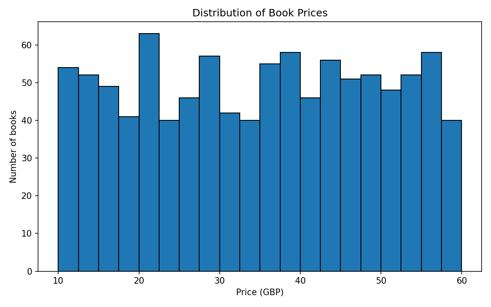
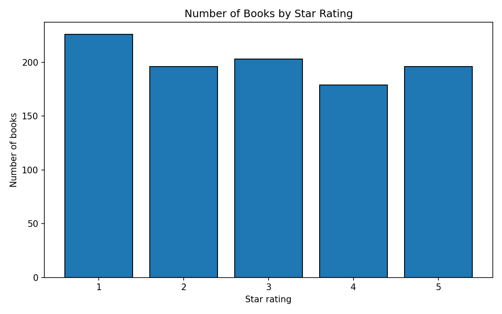
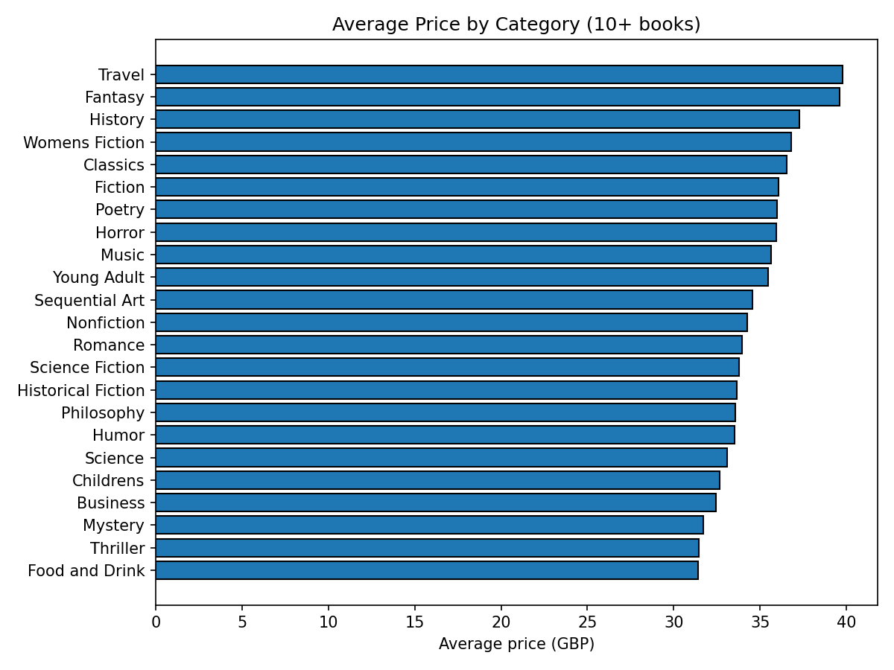

# Online Bookstore Price & Rating Analysis

A web scraping and data analysis project built for the CodeAlpha Data Analytics internship. It scrapes all 1,000 books from [Books to Scrape](https://books.toscrape.com/) (a site built for practicing web scraping), cleans the data, and analyzes prices, ratings, and categories.

## What this project does

1. **Scrapes** title, price, rating, availability, and product URL for every book across all 50 listing pages
2. **Collects categories** by visiting each of the site's 50 category pages and mapping every book to its category
3. **Cleans** the data (converts prices from text like `£51.77` to numbers, checks for missing values and duplicates)
4. **Analyzes** prices, ratings, and categories
5. **Visualizes** the results with three charts

## Tools used

Python, requests, BeautifulSoup, pandas, matplotlib

## Project structure

| File | Purpose |
|---|---|
| `scraper.py` | Scrapes all 50 pages and saves `books.csv` |
| `categories.py` | Visits each category page and saves `category_map.csv` |
| `clean.py` | Merges the two files, cleans the data, saves `books_clean.csv` |
| `analysis.py` | Prints summary statistics and category analysis |
| `charts.py` | Creates the charts in the `images/` folder |
| `requirements.txt` | Python libraries needed |

## How to run

```
python -m pip install -r requirements.txt
python scraper.py
python categories.py
python clean.py
python analysis.py
python charts.py
```

Run the scripts in this order. The scraping steps take a couple of minutes each because the scripts pause briefly between requests to be polite to the website, and they retry automatically if a request times out.

## Dataset

`books_clean.csv` has 1,000 rows and these columns:

| Column | Description |
|---|---|
| `title` | Book title |
| `category` | Category listed on the site |
| `price` | Price in GBP (number) |
| `rating` | Star rating, 1 to 5 |
| `in_stock` | True/False availability |
| `product_url` | Link to the book's page |

## Key findings

- **Prices** range from £10.00 to £59.99, with a mean of £35.07 and a median of £35.98. The mean and median are close, so there are no extreme outliers.
- **Ratings are spread almost evenly** across 1 to 5 stars (between 179 and 226 books at each level). This is unlike a real store, where ratings usually skew high, and suggests the demo site's data is generated.
- **Price and rating are not related.** Average price stays between about £34.50 and £36.10 at every star level, so higher-rated books do not cost more.
- **Prices differ only slightly by genre.** Among genres with at least 10 books, average prices range from £31.41 (Food and Drink) to £39.79 (Travel), with Fantasy close behind at £39.59.

### Charts







## Data notes and limitations

- Books to Scrape is a practice site with fictional data, so these findings illustrate the analysis process and should not be read as real market insights.
- "Default" (152 books) and "Add a comment" (67 books) are catch-all labels used by the site, not real genres. They were excluded from the genre comparison.
- Many categories contain only one or two books, so category averages were only compared for categories with at least 10 books.
- All 1,000 books were listed as in stock at scrape time, so the `in_stock` column was not used in the analysis.
- One title ("The Star-Touched Queen") appears twice with different prices and URLs. Both rows were kept because they are separate products on the site.

## Author

[Saron Belayneh] | [linkedin.com/in/saron-asrat] | [https://github.com/Sasa20267]