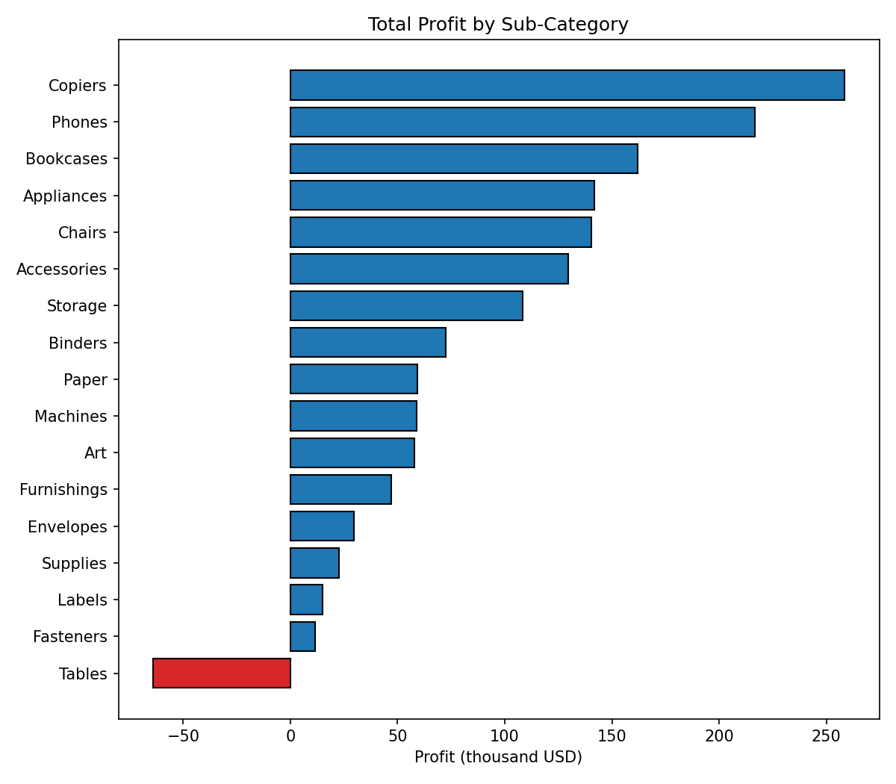
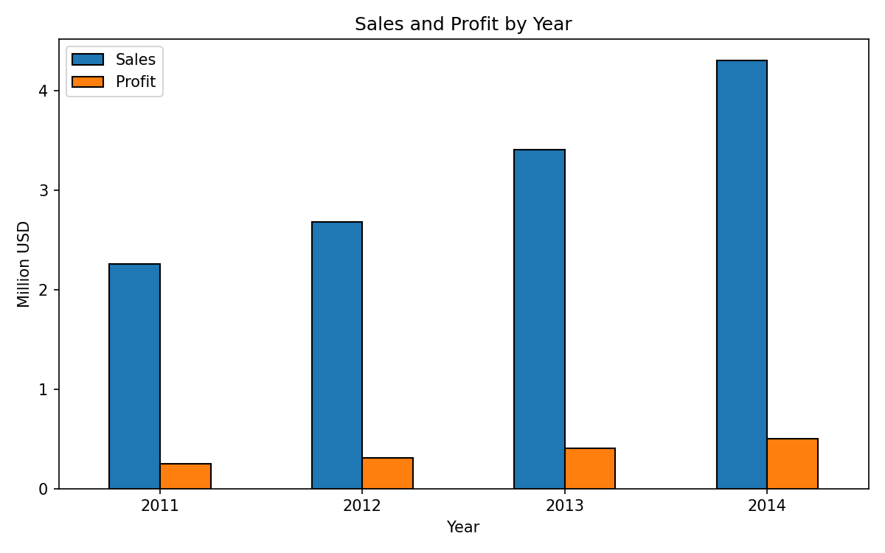
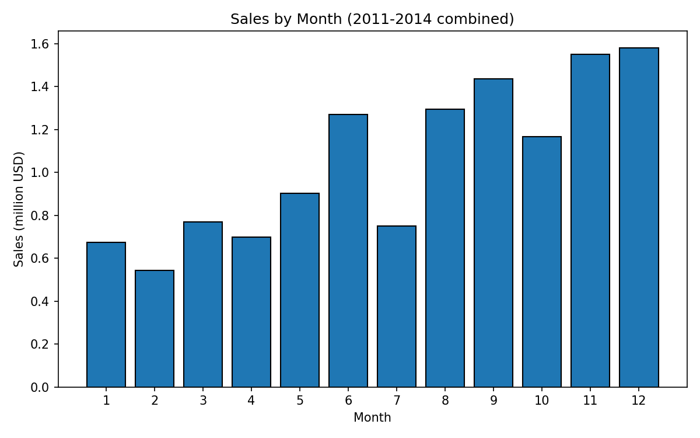
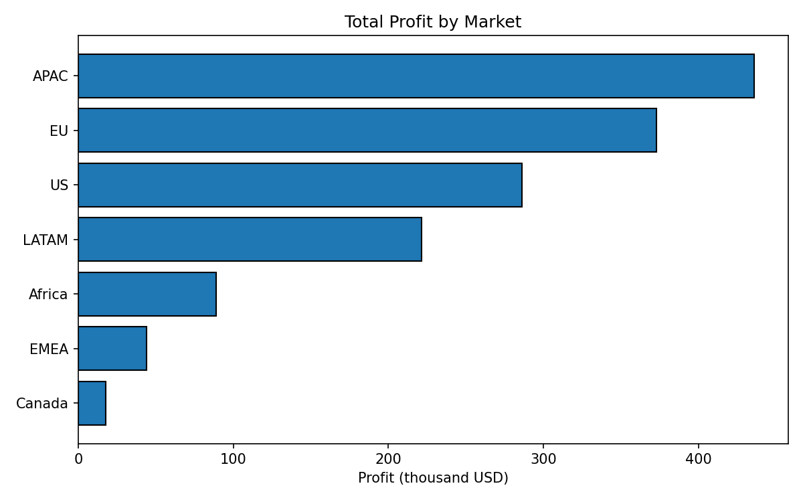
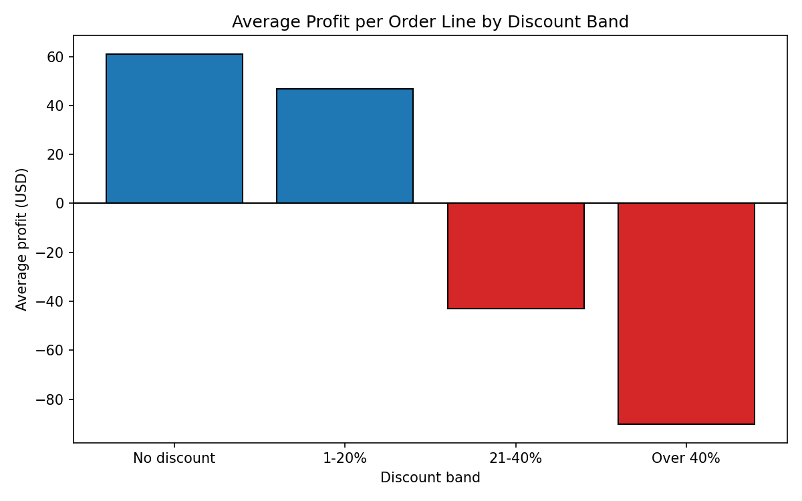

# Superstore Sales & Business Performance Analysis

An exploratory data analysis (EDA) of the Global Superstore retail dataset, built for the CodeAlpha Data Analytics internship. The project cleans the data, answers five business questions about sales and profit, and tests one hypothesis statistically.

## Business questions

1. Which categories and sub-categories drive the most sales and profit?
2. Which markets and regions perform best, and where does the business lose money?
3. How do sales and profit change over time, and is there seasonality?
4. Does a higher discount lead to lower profit? (tested statistically)
5. Do customer segments differ in profitability?

## Dataset

- **Source:** Global Superstore dataset (Kaggle), file `Global_Superstore2.csv`
- **Size:** 51,290 rows and 24 columns. Each row is one order line (one product within an order).
- **Period:** January 2011 to December 2014
- **Currency:** not stated in the file; amounts are shown in USD as the most likely currency.

## Data cleaning and checks

- No duplicate rows, and no missing values except `Postal Code` (41,296 missing). Postal codes appear to exist only for some countries and were not needed, so the column was dropped.
- `Order Date` and `Ship Date` were stored as text (day-month-year) and converted to real dates.
- Added `Year`, `Month` and a `Loss` flag (True when profit is negative).
- Profit ranges from -$6,600 to +$8,400 per line, and 12,544 lines (about 24%) lost money. These extreme values were kept, since they are real orders and are part of the story.

## Key findings

- **Overall:** about $12.6M in sales and $1.47M in profit, a profit margin of 11.6%.
- **Categories:** Technology earned the most profit ($664K, 14.0% margin). Furniture has sales almost as large ($4.1M) but a margin of only 6.9%, and 31.6% of its lines lost money.
- **Tables lose money.** The Tables sub-category sold $757K but lost $64K overall (margin -8.5%), and 57.6% of its lines lost money. It was discounted on average 29.1%, about double the 14.0% of other products. Copiers was the most profitable sub-category ($259K, 17.1% margin).
- **Markets:** APAC earned the most profit ($436K), followed by EU ($373K) and US ($286K). EMEA had the weakest margin (5.4%). Southeast Asia had a margin of only 2.0%, with 53.3% of its lines losing money.
- **Trends:** sales grew every year, from $2.26M in 2011 to $4.30M in 2014, while the margin stayed steady between 11.0% and 11.9%. November and December are the strongest months, and February is the weakest.
- **Discounts and profit:** undiscounted lines never lost money (average profit $61 per line), but 76.2% of lines discounted 21-40% and 98.4% of those discounted over 40% lost money. Spearman correlation between discount and profit is -0.596 (p < 0.001), so the null hypothesis of no relationship was rejected.
- **Segments** (Consumer, Corporate, Home Office) have very similar margins (11.5%, 11.5%, 12.0%): they differ in sales volume, not profitability.

### Charts











## Limitations

- The discount result shows an **association, not proof of cause**. Discounted products may also differ in cost, shipping, or product mix.
- Region names such as Central, North, South, East and West are reused across several markets (for example, "Central" mixes EU, LATAM and US rows), so Market is used as the main geographic breakdown.
- Canada has only 384 rows ($67K in sales), so its very high margin (26.6%) is not reliable and was not ranked.
- The dataset is a public practice dataset, so findings illustrate the analysis process and are not real business advice.

## Project structure

| File | Purpose |
|---|---|
| `explore.py` | First look: shape, data types, missing values, summary statistics |
| `clean.py` | Cleans the data and saves `data/superstore_clean.csv` |
| `analysis.py` | Totals and profit by category, sub-category, market, region and segment |
| `trends.py` | Yearly and monthly trends |
| `discount.py` | Discount bands and the Spearman correlation test |
| `charts.py` | Creates the charts in `images/` |
| `data/` | Raw and cleaned data |
| `requirements.txt` | Python libraries needed |

## How to run

```
python -m pip install -r requirements.txt
python clean.py
python analysis.py
python trends.py
python discount.py
python charts.py
```

## Tools used

Python, pandas, matplotlib, scipy

## Author

[Saron Belayneh] | [linkedin.com/in/saron-asrat] | [https://github.com/Sasa20267]